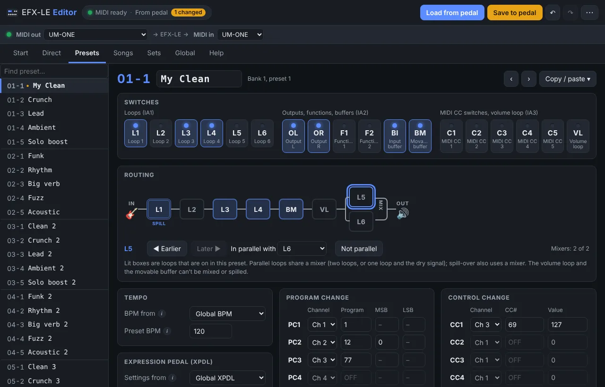
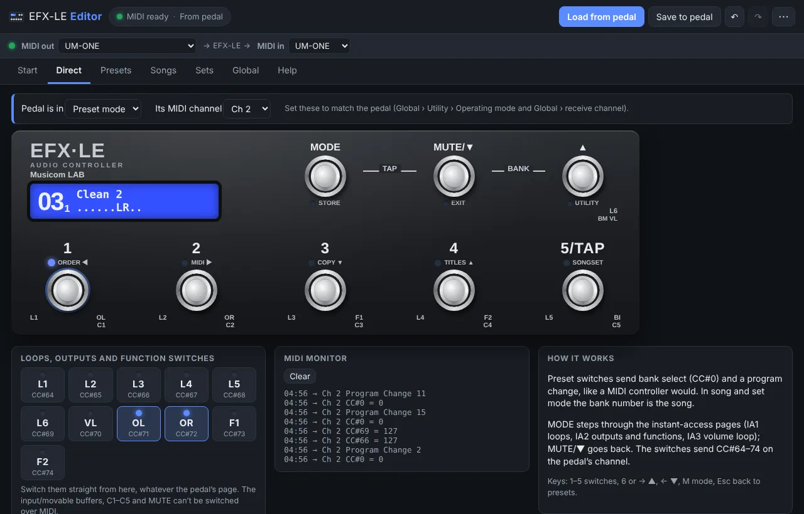
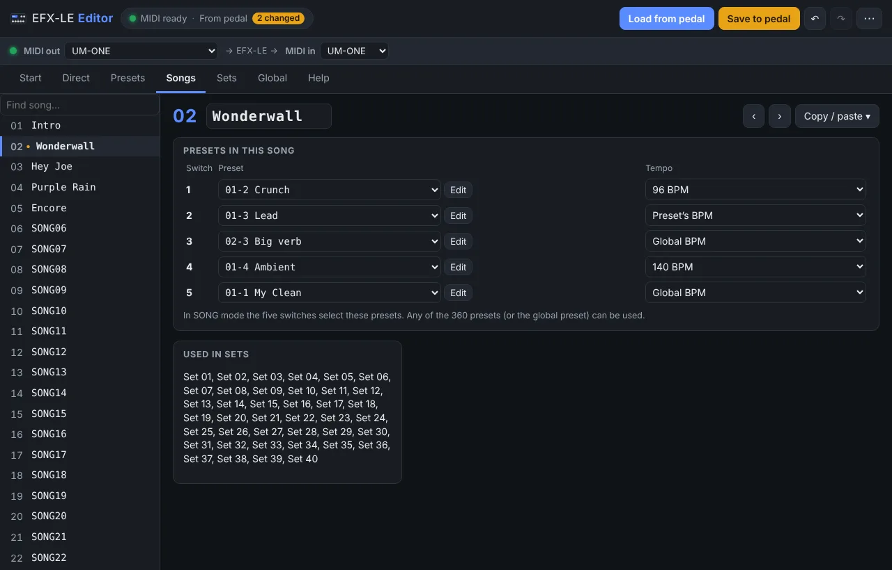
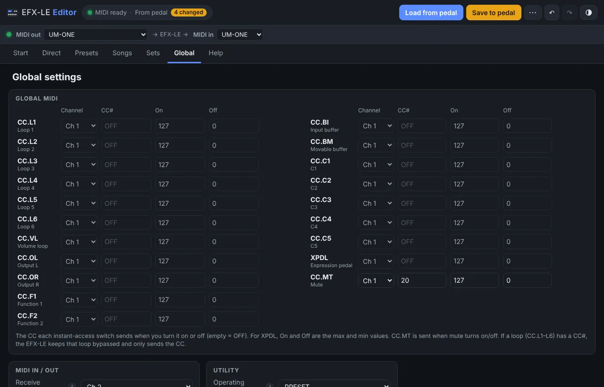
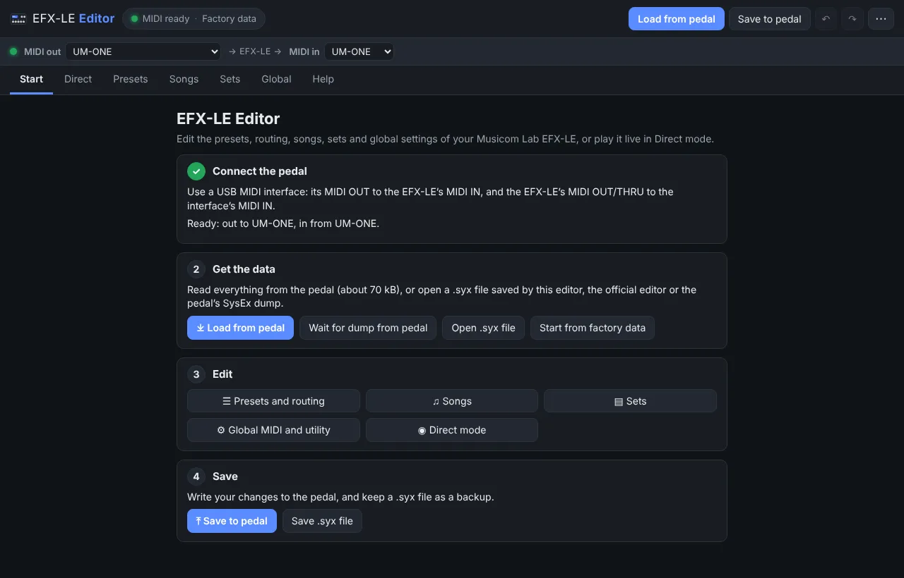

# EFX-LE Editor (web)

A modern, graphical editor for the **Musicom Lab EFX-LE** audio controller / loop switcher. It runs in the browser
and talks to the EFX-LE over a USB MIDI interface – an easier alternative to the old Windows/macOS editor.

> Works in **Chrome or Edge** on a computer (Web MIDI with SysEx). Save a backup (**⤓ Load from pedal**, then
> **Save .syx file**) before you write anything to the pedal. Not affiliated with Musicom Lab.

**[Open the editor](https://jonsolberg.github.io/efx-le-loop-swither-editor/)** ·
[More music apps on jonsolberg.se](https://jonsolberg.se:8080/music.html)

  

  
  
  
  

## Features

- **Choose your MIDI devices** – pick the MIDI input and output the EFX-LE is connected to, right in the editor
  (handy when you have several interfaces). The choice is remembered.
- **All 360 presets and the global preset**: title, loops L1–L6, volume loop, outputs L/R, function switches F1/F2,
  input and movable buffers, the C1–C5 MIDI CC switches, BPM, expression pedal (XPDL), 8 Program Change and
  8 Control Change messages
- **Graphical routing**: change the loop order, put loops in parallel (mixer) and set spill-over, with the same
  rules as the pedal (two mixers, which loops can be mixed)
- **Songs and sets**: 99 songs of five presets with their own BPM, 40 sets of 40 songs
- **Global settings**: the 20 global MIDI CC assignments, MIDI IN channel, MIDI OUT/THRU and all utility settings
- Copy, paste, swap and initialise presets; copy one preset's routing to all; undo/redo
- **Load from / save to the pedal** over MIDI SysEx, and open/save `.syx` files (70,656 bytes – the same files the
  official editor and the pedal's MIDI SYSEX DATA menu use)
- **Direct mode**: an on-screen EFX-LE. Step through banks and presets, switch loops, outputs and function switches
  live, with a MIDI monitor
- Light/dark theme, works on tablets and phones (with a MIDI interface that the browser supports)

## Getting started

1. Connect a USB MIDI interface: its **MIDI OUT** to the EFX-LE's **MIDI IN**, and the EFX-LE's **MIDI OUT/THRU**
   to the interface's **MIDI IN**. Musicom Lab recommends the Roland UM-ONE or M-Audio Uno.
2. Open the [editor](https://jonsolberg.github.io/efx-le-loop-swither-editor/) in Chrome or Edge and allow MIDI
   (with SysEx) when the browser asks.
3. Choose the interface under **MIDI in** and **MIDI out**.
4. **⤓ Load from pedal** reads all the pedal's data (about 70 kB). Save a `.syx` backup.
5. Edit, then **⤒ Save to pedal**. Sending everything takes about 30 seconds.

The EFX-LE's MIDI OUT/THRU jack must be set to **OUT** (Global › MIDI IN/OUT) for loading, otherwise the pedal's
reply is not sent back. If the pedal doesn't answer a load request, start the dump on the pedal instead: hold
**MODE** › **UTILITY** › **MIDI SYSEX DATA** › **DUMP**, while the editor waits for data.

### Browsers

| | Load / save to pedal | Direct mode | `.syx` files |
|---|---|---|---|
| **Chrome, Edge, Opera** (computer, Android) | ✅ | ✅ | ✅ |
| **Firefox** (computer) | ✅ after allowing the site's MIDI add-on | ✅ | ✅ |
| Safari, iPhone/iPad | ❌ no Web MIDI | ❌ | ✅ edit files only |

Use the editor from its web address. Browsers only allow MIDI SysEx on secure (https) pages.

## Direct mode

Direct mode uses the EFX-LE's own MIDI implementation (manual chapter 6), on the pedal's MIDI IN channel:

| Message | Does |
|---|---|
| CC#0 (bank select) + Program Change | selects a preset (presets are numbered 1–360 in blocks of 128) or, in song and set mode, a song's preset |
| CC#64–69 | loops 1–6 (0–63 off, 64–127 on) |
| CC#70 | volume loop |
| CC#71 / 72 | output L / R |
| CC#73 / 74 | function switch 1 / 2 |

The EFX-LE doesn't report its state over MIDI, so the on-screen switches follow the loaded preset data and your
presses. MUTE, TAP and the buffers can't be controlled over MIDI.

## The SysEx format

The EFX-LE stores 512 blocks of 128 bytes. A dump is 512 SysEx messages of 138 bytes:
`F0 00 21 06 00 06 7F <block hi> <block lo> <128 data bytes> F7`. The editor asks for a dump with
`F0 00 21 06 00 06 10 F7`.

| Blocks | Contents |
|---|---|
| 0–359 | presets (bank 1 preset 1 … bank 72 preset 5) |
| 360 | global preset |
| 361–459 | songs 1–99 |
| 460–499 | sets 1–40 |
| 510 | global MIDI |
| 511 | utility settings |

A preset block: bytes 0–2 switch states, 8–15 and 20–27 routing, 40–45 XPDL, 46–47 BPM, 48–79 Program Change,
80–103 Control Change, 104–115 title. Values above 127 are stored as 7 bits plus a flag bit in a neighbouring
byte. See [`web/js/efx.js`](web/js/efx.js) for the full map.

## Building

Plain HTML/CSS/JS in [`web/`](web), no build step. Open `web/index.html` or serve the folder. The `pages` workflow
publishes it to GitHub Pages. `node test/model.test.js` runs the tests for the data model.

## Credits

The SysEx format was worked out from Musicom Lab's EFX-LE Editor V1.41 and the EFX-LE Owner's Manual (version 1.4x).
EFX-LE and Musicom Lab are trademarks of Musicom Lab; this project is not affiliated with them.

## Support

The editor is free, open source and has no ads. If you find it useful, you can
[support me on Ko-fi](https://ko-fi.com/jonsolberg) ❤️

## License

Copyright © 2026 Jon Solberg

This program is free software: you can redistribute it and/or modify it under the terms of the
GNU General Public License as published by the Free Software Foundation, either version 3 of the
License, or (at your option) any later version.

This program is distributed in the hope that it will be useful, but WITHOUT ANY WARRANTY; without
even the implied warranty of MERCHANTABILITY or FITNESS FOR A PARTICULAR PURPOSE. See the
[GNU General Public License](LICENSE) for more details.
